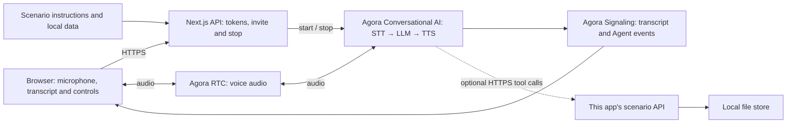

# Voice Shopping Assistant

Compare electronics and confirm an unpaid simulated order.

[Try locally](#2-try-the-demo) · [Source on GitHub](https://github.com/littleDogWang/09-voice-shopping) · [Build with AI](#build-with-ai)

TypeScript · Web · Next.js 16 / React 19 · Agora Conversational AI

## 1. Overview

A voice shopping experience for six fictional microphones and cameras. Users can compare products, edit a basket through the browser, review a server-priced quote and save or cancel an unpaid simulated order. With tools enabled, the voice assistant uses the same shopping session as the page.

- A fixed catalog with product attributes, USD prices and simulated stock.
- A shared browser basket, server-generated quote and explicit order confirmation.
- File-backed unpaid orders, lookup and cancellation that releases simulated stock.

**Default conversation:** The assistant compares prompt catalog facts and summarizes purchase intent, but cannot edit the basket, generate server quotes or save/cancel orders by voice. Browser business controls remain available independently.

**With business tools enabled:** Seven session-bound tools can search products, inspect inventory, read/edit the basket and confirm, look up or cancel an unpaid order.

**Scope:** There is no real purchase, payment, shipping, tax calculation, fulfillment or refund. Prices are server-derived; any cart edit requires a new quote review and explicit confirmation.

## 2. Try the Demo

Run [Quick Start](#5-quick-start), open [http://localhost:3000](http://localhost:3000), allow microphone access and choose **Start voice shopping**. A voice session starts only after your action. The Agora project must be configured even in default conversation mode; “local data” does not mean offline speech or a local LLM.

| Try | Say | Expected behavior |
| --- | --- | --- |
| Compare options | I need a microphone for video calls. What can I get within my budget? | It asks for use and budget, then compares only configured product facts. |
| Review and confirm | Add the option I chose, then read back everything in the basket before I confirm. | In tool mode, it reads the current server quote and asks for explicit agreement before saving an unpaid order. |
| Cancel the result | Cancel the unpaid order we just created. | In tool mode, it identifies that order and asks for cancellation confirmation; a successful result is cancelled, not refunded. |

Rows that describe tool actions require the optional public HTTPS tool configuration. In default mode, expect the limitations described above. These are acceptance cases to try, not a claim that a live voice run has passed. For the full scenario matrix, see [acceptance.md](scenarios/09-voice-shopping/acceptance.md).

## 3. Architecture & Tech Stack



| Component | Role |
| --- | --- |
| Agora RTC | Carries user microphone audio and synthesized Agent speech. |
| Agora Signaling (RTM) | Delivers transcript, Agent state, metrics and error events to the browser. |
| Agora Conversational AI | Runs the managed voice pipeline and configured business tools. |
| Next.js route handlers | Keep the App Certificate server-side, issue combined RTC/RTM tokens and manage Agent sessions. |
| Scenario modules | Supply instructions, demo data and the optional business API/tool contracts. |

The client uses `agora-rtc-react`, `agora-rtc-sdk-ng`, `agora-rtm` and `agora-agent-client-toolkit`; the server uses `agora-agents`. The configured pipeline is Deepgram nova-3 → OpenAI gpt-4o-mini → MiniMax speech_2_6_turbo with English speech. See [the invite route](app/api/invite-agent/route.ts) and [runtime profile](scenarios/runtime-profile.ts) when changing providers. No separate vendor API key is required for the default Agora-managed configuration.

## 4. Prerequisites & Configuration

- Node.js 22 or newer and pnpm 9.15.9.
- An Agora project with its App Certificate enabled, and access to RTC, Signaling and Conversational AI.
- Access to this repository. Cloning or sharing the source requires appropriate repository permissions.
- A browser with microphone access; use HTTPS for a hosted app.

| Variable | Required? | Where / purpose |
| --- | --- | --- |
| `NEXT_PUBLIC_AGORA_APP_ID` | Required | App ID from your Agora Console project. |
| `NEXT_AGORA_APP_CERTIFICATE` | Required | App Certificate from the same project; server-side only. |
| `TOP_TEN_SCENARIO_TOOL_BASE_URL` | Optional | Public HTTPS origin of this same app, reachable by Agora cloud; enables the business tools described below. |
| `SHOPPING_DATA_FILE` | Optional | Optional path to the persistent shopping JSON ledger; use a separate temporary path for checks. |

Create or select your project in [Agora Console](https://console.agora.io/), copy the App ID and enable/copy its App Certificate. Put them in `.env.local` using [env.local.example](env.local.example). Never prefix the certificate with `NEXT_PUBLIC_`, put it in client code or commit it.

Leave `TOP_TEN_SCENARIO_TOOL_BASE_URL` unset for the default conversation. To enable tools, deploy the same app at a reachable public HTTPS origin, set that variable on the server, restart/redeploy and start a fresh conversation. HTTP, localhost/private origins, malformed URLs and URLs with credentials, query or fragment are rejected. URL validation does not establish actual cloud reachability. In tool mode, a failed call must not be disguised as a successful fixture-based action.

## 5. Quick Start

From a terminal, clone this scenario rather than the generic starter:

```bash
git clone https://github.com/littleDogWang/09-voice-shopping.git
cd 09-voice-shopping
pnpm install --frozen-lockfile
cp env.local.example .env.local
```

Edit `.env.local` and fill the two required Agora values from section 4. Then run these commands from the cloned repository root:

```bash
pnpm run doctor
pnpm run dev
```

Alternatively, if the [Agora CLI](https://github.com/AgoraIO/cli) is already installed, bind your project with `agora login`, `agora quickstart env write . --template nextjs --project <your-project> --json` instead of manually copying credentials. Use your actual project identifier in place of `<your-project>`.

Open [http://localhost:3000](http://localhost:3000), choose **Start voice shopping**, allow the microphone and try the first conversation above. Check that you can hear the assistant and see both speakers in the transcript. Then verify the scenario result under the configured mode; a transcript alone does not establish that a business action occurred.

## 6. How It Works

| User step | Assistant / application behavior | Result |
| --- | --- | --- |
| Describe a budget and use case | Search and compare configured products; tool mode checks server inventory. | Documented choices without invented prices or stock. |
| Choose items and quantities | Read the shopping session and set total quantities, not increments. | A new server-priced quote shared with the browser basket. |
| Confirm the exact quote | Create the unpaid order only after explicit consent; look up/cancel within the same session. | A saved order number/status, or a stock/quote error with the basket preserved. |

### Tools and result semantics

`search_products`, `get_inventory`, `get_shopping_session`, `set_cart_item`, `confirm_order`, `get_order` and `cancel_order` use the shopping API. `shopping_session_id` is validated by invite and fixed into tool paths. Quantity zero removes an item. Quote changes invalidate earlier confirmation; a repeated confirmed quote returns its original order.

The invite additionally requires `shopping_session_id`, created by the shopping session API and shared with the browser. The supplied browser already handles this startup sequence. See [the scenario guide](scenarios/09-voice-shopping/README.md) for additional behavior and contracts.

## 7. Customize for Your Business

| Change | Source | How |
| --- | --- | --- |
| Catalog and prices | [catalog.json](scenarios/09-voice-shopping/catalog.json) | Replace fictional products, specifications, USD prices and initial stock. |
| Basket, quotes and orders | [shopping.ts](scenarios/09-voice-shopping/shopping.ts) | Adapt storage and business rules; retain server pricing, current-quote confirmation and idempotency. |
| Conversation | [config.ts](scenarios/09-voice-shopping/config.ts) | Change buying questions and summaries without bypassing consent or describing simulated orders as paid. |

To connect a commerce backend, replace shopping.ts persistence and stock operations with your authorized cart/order service while preserving session scope and quote validation. Test a stale quote and an out-of-stock item. Payment and shipping need separate integrations and separately confirmed outcomes.

Shared integration points:

- [scenarios/index.ts](scenarios/index.ts) assembles the selected scenario prompt.
- [scenarios/tool-contracts.ts](scenarios/tool-contracts.ts) defines business tool schemas and server-bound routes.
- [app/api/invite-agent/route.ts](app/api/invite-agent/route.ts) selects the prompt, providers, turn detection and session settings.
- [scenarios/presentation.ts](scenarios/presentation.ts) selects the scenario presentation; edit its scenario module for visible content.
- [docs/ai/RECIPE.md](docs/ai/RECIPE.md) retains the machine-readable integration profile and lifecycle contracts.

Keep combined RTC/RTM token generation, the StrictMode initialization guard, toolkit local-user UID remapping and interrupted transcript turns intact. Let the Agora React hooks own microphone and RTC teardown. Preserve server-bound business session scope when extending tools.

### Build with AI

After cloning this repository, paste the following into your coding agent from your own application workspace, providing the path to the clone:

```text
Implement the Voice Shopping Assistant recipe in my application.

Read RECIPE.md in the cloned 09-voice-shopping repository first, then inspect
its scenario modules, tool contracts and invite route. Read docs/ai/RECIPE.md
and AGENTS.md in that repository for integration constraints.

Inspect my application's existing stack and instructions before editing.
Reuse the source's RTC/RTM token, session and transcript patterns.
Implement the scenario's default conversation first, then connect only the
business tools I request. Keep demo data and real service results distinct.
Explain the credentials and configuration I need to supply.
Ask before adding dependencies. Follow my rules for local edits, verification,
commits and remote writes. Verify the result without claiming unrun live tests.
```

This prompt is a source-guided integration entry point, not a published scaffolding package or an automatic Console import.

## 8. Deployment & Validation

### Deploy

Use one Node process with persistent writable disk for the atomic JSON ledger. `SHOPPING_DATA_FILE` can choose the ledger path. The browser keeps a bearer shopping-session ID in localStorage; it is not customer login. Ephemeral or multi-process hosting cannot provide this store's persistence guarantees.

Install dependencies and set the same required environment variables in your deployment platform's secret store. Build with `pnpm run build` and, on a Node host, start with `pnpm run start`. Keep the public app on HTTPS. For voice tools, set `TOP_TEN_SCENARIO_TOOL_BASE_URL` to the deployed app's reachable HTTPS origin and verify cloud callbacks against that same running instance.

These commands describe the repository's supported scripts; they do not attest to an existing deployment. Before opening sample endpoints to real users, add application authentication, authorization and appropriate request limits.

### Docker deployment

```bash
docker build --build-arg NEXT_PUBLIC_AGORA_APP_ID=YOUR_AGORA_APP_ID -t 09-voice-shopping:local .
docker run --rm -p 3000:3000 --env-file .env.local --mount source=09-voice-shopping-data,target=/app/.scenario-data 09-voice-shopping:local
```

Replace `YOUR_AGORA_APP_ID` with the public App ID used in `.env.local`. Next.js embeds that identifier in the browser bundle, so changing projects requires rebuilding the image. The App Certificate is supplied only at container runtime. The named volume preserves the non-root-owned `.scenario-data` directory. Leave custom host storage variables unset inside Docker or map them to the mounted directory; a host absolute path is not automatically mounted.

`pnpm run verify:docker` independently builds the image with synthetic credentials, starts an isolated localhost-bound container, checks the home page and a scenario route, then removes only that container. It does not contact Agora or prove a live voice session.

### Check locally

From this repository root:

```bash
pnpm run verify:template
pnpm run lint
pnpm run typecheck
pnpm run verify:api
pnpm run verify:scenario
pnpm run verify:shopping
pnpm run build
```

With the local prerequisites and credentials configured, also run `pnpm run verify`. The canonical verify script includes all of the local scenario checks above; Docker is deliberately verified separately. Local checks do not require a real microphone call and do not prove cloud tool execution.

### Verify a real conversation

1. Start a fresh voice session; check two-way audio and both transcript speakers.
2. Try the normal, correction and unsupported/failure paths in section 2.
3. Test browser basket editing without voice tools, then tool-mode editing and exact-quote consent. Check unpaid-order lookup, refresh and cancellation. A stale quote or unavailable stock must fail without silently substituting an item.
4. End the call and confirm that microphone publication and the Agent session stop. Keep evidence of the actual result separately from the transcript.

### Troubleshooting

| Symptom | Check |
| --- | --- |
| Agent does not join | Check the token/invite response and run pnpm run doctor. If using the Agora CLI, run agora project doctor --deep. |
| Audio works but transcript is missing | Check RTM login/subscription and keep RtcTokenBuilder.buildTokenWithRtm in the token route. |
| Browser has no microphone | Grant permission, select an input device and use localhost or a secure HTTPS page. |
| The assistant discusses the task but does not save or change it | Check whether the optional public tool origin is enabled. The default conversation has the limits in section 1. |
| A tool fails or a result disappears | Inspect the actual API error, callback reachability and this scenario's storage/lifetime limits; do not claim success from speech alone. |

See [the contributor guide](AGENTS.md), [scenario guide](scenarios/09-voice-shopping/README.md) and [MIT License](LICENSE) for further details.
